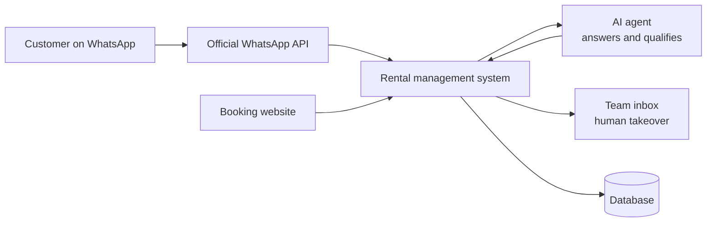

# Car Rental Management System with AI Customer Service — Case Study

> Management system for car rental companies with a built-in customer service inbox on the **official WhatsApp API** and an **AI agent that handles customer conversations**.
> **Source code is private.** This repository documents the project; a live demo is available on request.

## The problem

Small and mid-sized rental companies juggle bookings, fleet and customers across spreadsheets and phones, and lose rentals because WhatsApp messages go unanswered outside business hours.

## What I built

- **Rental management** — fleet, bookings and customers in one system.
- **Customer service inbox** integrated with the **official WhatsApp Business API**, so the team works every conversation from one screen.
- **AI agent** that answers customers on WhatsApp end to end — availability, prices and booking questions — with the conversation visible to the team, who can step in at any time.
- **Public booking website** (WordPress + Elementor) that reads fleet, prices and rules from the system, so nothing is registered twice and the site never diverges from the back office.
- **Pricing engine** — rates per category, seasons, weekends, taxes and fees, add-ons and packages, pickup locations with their own fees.

## Architecture

## Stack

Next.js (App Router) + React · TypeScript · PostgreSQL with Drizzle ORM · Better Auth · Zod · Tailwind + Radix UI · Docker on a VPS. Quality gates: Vitest, ESLint, dependency-cruiser, Knip and jscpd.

## My role

Product design, architecture, full stack development, WhatsApp API and AI integration, and deployment.

---
Built by **Victor Sestrem** · [LinkedIn](https://www.linkedin.com/in/victor-sestrem/) · victor-sestrem@hotmail.com
